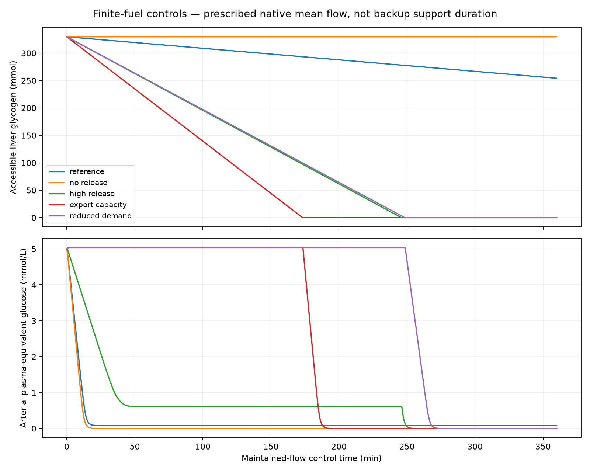

# M4 finite-fuel verification

Completed 2026-10-09. **Verified at explicit exploratory-model scope. No recoverable support time is established.**

7 coupled short scenarios and 9 maintained-flow controls; 32 paired integrations. [Equations, sources and limitations](../../docs/m4-fuel-accounting.md). [Machine-readable results and provenance](manifest.json).

## Coupled short replays

Original organ demand is retained. Actual glucose withdrawal is tied to actual oxygen consumption; finite oxygen stores and respiratory feedback remain active. Nearly empty glucose is a numerical stress condition, not a proposed subject state. BIO retains 10 mL O2/min additional assumed working-myocardium demand.

| Case | Duration (s) | Unmet O2 (mL) | Glucose exported (mmol) | Final glycogen (mmol) | Paired glucose-state difference (mmol) |
|---|---:|---:|---:|---:|---:|
| native_cycle | 0.75 | 0.000165201 | 0.002625 | 329.757375 | 3.46e-06 |
| B1_reference | 8 | 0.23058 | 0.028 | 329.732000 | 6.01e-06 |
| B1_low_glucose | 8 | 34.0723 | 0.028 | 329.732000 | 7.7e-10 |
| B1_liver_loss | 8 | 0.23058 | 0 | 329.760000 | 2.26e-07 |
| handover | 8 | 0.313497 | 0.028 | 329.732000 | 2.24e-07 |
| E1_fed | 8 | 0.308866 | 0.028 | 329.732000 | 1.88e-07 |
| BIO | 8 | 0.838345 | 0.028 | 329.732000 | 8.1e-08 |

These are fuel/oxygen results, not new hydraulic success claims: the historical BIO pressure failure remains. Initial normal blood glucose buffers a short interruption in liver release, but does not remove instantaneous glucose-delivery limitations. The native-cycle control explicitly tests this: no tissue glucose buffer is credited, so pulsatile glucose delivery can limit uptake despite the existing oxygen buffer. The oxygen-only baseline remains verified; a fully physiological joint-fuel resting baseline is **not established**. This limitation must accompany M5 searches.

## Long controls: distinguish release from stock

These six-hour glucose-only calculations impose fixed, balanced mean native flow and fixed mean blood volumes. They presume oxygen availability for requested glucose use. They do not simulate long-duration backup haemodynamics, respiratory failure, pump energy, injury or reperfusion. Times below bracket the first **sampled numerical glucose-demand shortfall**, using 10-second samples and a 1e-8 mmol/s numerical rate tolerance; they are not clinical thresholds or safe durations.

| Control | Release cap (mmol/min) | Export increment cap (mmol/L) | Initial glycogen (mmol) | First sampled shortfall bracket (min) | Glycogen left at 6 h (mmol) |
|---|---:|---:|---:|---|---:|
| mean_reference | 0.21 | 1 | 329.760 | 8.50–8.67 | 254.16 |
| mean_no_release | 0 | 1 | 329.760 | 7.50–7.67 | 329.76 |
| mean_total_output_scale | 0.790981 | 1 | 329.760 | 12.83–13.00 | 45.0068 |
| mean_high_release | 2.1 | 1 | 329.760 | 25.33–25.50 | 0 |
| mean_export_capacity | 2.1 | 3 | 329.760 | 180.83–181.00 | -3.37386e-14 |
| mean_low_store | 2.1 | 1 | 230.400 | 25.33–25.50 | 0 |
| mean_high_store | 2.1 | 1 | 394.560 | 25.33–25.50 | -6.07536e-276 |
| mean_reduced_demand | 2.1 | 1 | 329.760 | 259.67–259.83 | -7.83072e-49 |
| mean_nonoxidative | 2.1 | 1 | 329.760 | 21.50–21.67 | -4.15399e-130 |

The 0.21 mmol/min scale is transferred from observed healthy fasting glycogenolysis; its use as a maximum is an assumption. The approximately 0.791 scale is transferred from **total** hepatic glucose output and is only a hypothetical glycogen-only comparator. The 2.1 scale is an A stress capacity, ten times the reference. Export increment, extraction and hepatic function are additional assumed limits. Larger stores cannot cure a delivery-rate bottleneck.



## Verification and reproducibility

- Maximum glucose-equivalent conservation error: **3.9e-11 mmol**.
- Maximum coupled oxygen conservation error: **6.82e-12 mL**; oxidation/glucose stoichiometry error: **4.26e-13 mL O2**.
- Maximum paired glucose-state difference: **6.01e-06 mmol** in short replays (limit 1e-5), **9.92e-08 mmol** in long controls (limit 1e-4).
- Maximum mean-flow balancing adjustment: **0.00221971 mL/s**; all corrected node balances below 1e-9 mL/s.
- Original-demand identities and physical state bounds are checked separately; no failed run is counted as a physiological success.
- Earlier RK45 pair settings were rejected: B1 reference glucose difference 1.12876e-5 mmol, and liver-loss difference 1.27589e-5 mmol. Tighter documented settings retained the 1e-5 criterion.

```powershell
.\.venv\Scripts\python.exe -m pytest -q
.\.venv\Scripts\python.exe scripts/run_m4_fuel.py
.\.venv\Scripts\python.exe scripts/report_m4_fuel.py
```

The manifest records parameters, software, input/output SHA-256 hashes, solver settings and both runs. `--manifest-only` consolidates existing matching protocol results; it does not rerun integration. Historical M4 oxygen-only artifacts remain historical and are not relabeled fuel-constrained.

## Gate disposition

The finite glycogen/glucose accounting obligation is complete at the declared restrictive exploratory scope. M4 can hand this tested constraint to M5. Mixed fuels, glucose regulatory physiology, nonoxidative cellular demand, liver function, preservation and reperfusion remain explicit limitations; no optimized pump or recoverable duration follows from this report.
