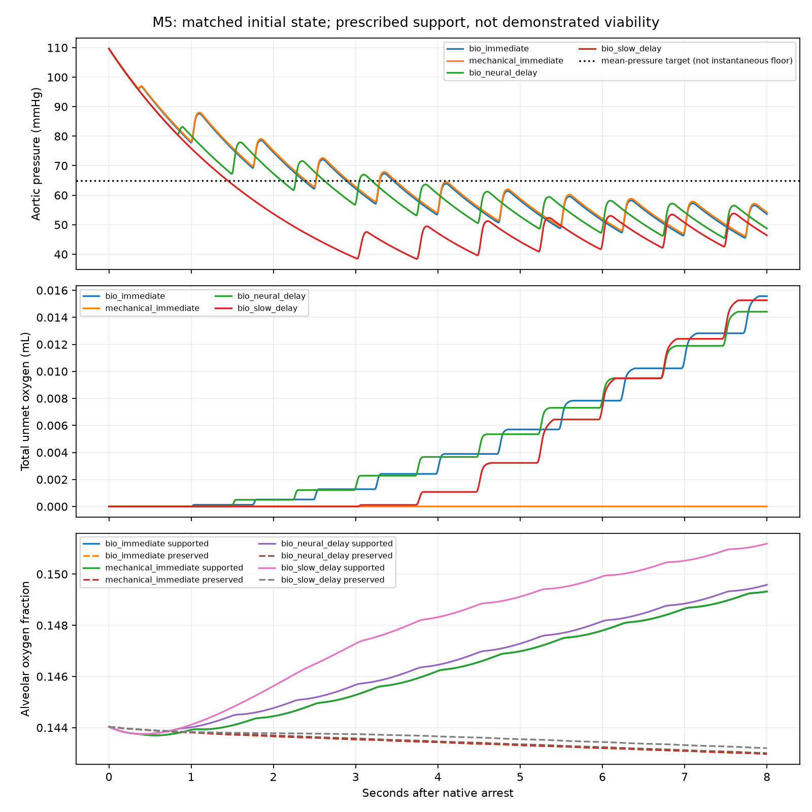

# M5 final architecture and startup comparison

2026-10-14. Four paired eight-second experiments; exploratory assumptions, not a validated support duration.

All cases start from the identical 5250 mL hydraulic inventory and native failure. Both devices have the same Smith-shaped chamber law, valve parameters, cavity scale and rate. The mechanical reference supplies that actuation externally and has no auxiliary myocardium. It is a finite chamber reference, not a realizable device or unlimited flow source.

Brain, native coronary branches, one kidney, hepatic artery and respiratory muscle branches retain full reference conductance. Other systemic branches have conductance fraction 0.25. Supported/preserved lungs have separate pulmonary and nutritive flow paths and gas stores: assumed equal lung shares, pulmonary factors 1/0.1, nutritive factors 1/0.25 and ventilation factors 1/0. These are sensitivity settings, not physiological minima. Both lungs share PA/PU blood reservoirs.

| Case | Release / ramp s | Final 2 s mean AO mmHg | AO min–max mmHg | Left output L/min | Chamber work J over 8 s |
|---|---:|---:|---:|---:|---:|
| bio_immediate | 0 / 1 | 51.918 | 45.534–58.223 | 1.7954 | 2.6000 |
| mechanical_immediate | 0 / 1 | 52.521 | 46.141–58.824 | 1.7922 | 2.6102 |
| bio_neural_delay | 0.5 / 1 | 52.090 | 45.479–58.127 | 1.7238 | 2.3481 |
| bio_slow_delay | 2 / 3 | 48.468 | 42.198–53.799 | 1.7176 | 1.4680 |

All final-window pressure screens fail. Flow is auxiliary left output, not a guarantee of organ delivery. The mechanical reference passes the first post-ramp diagnostic window at 1.0–2.5 s, but fails the final pressure screen; no BIO case passes. This is transient screening success, not sustained support. The diagnostic is: a 1.5 s window with mean AO ≥65, minimum ≥50, maximum ≤90 mmHg, positive mean bilateral output and no previous sampled oxygen shortfall in any modeled organ. Windows are scanned every 5 ms after the ramp. These are declared project screens, not validated clinical survival thresholds.

| Case | Requested auxiliary O2 mL | Unmet auxiliary O2 mL | First auxiliary shortfall s | Requested BIO equivalent J | External input J at eta=0.5 |
|---|---:|---:|---|---:|---:|
| bio_immediate | 0.624749 | 0.015532 | 1.005–1.010 | 12.6777 | 3.8307 |
| mechanical_immediate | 0.000000 | 0.000000 | none | 0.0000 | 3.8533 |
| bio_neural_delay | 0.578359 | 0.014386 | 1.490–1.495 | 11.7363 | 3.4100 |
| bio_slow_delay | 0.409013 | 0.015246 | 3.025–3.030 | 8.2999 | 2.0264 |

External-input columns are hypothetical port-energy equivalents for each trajectory; only the mechanical row draws that external source in the modeled comparison. Efficiencies 0.25/0.5/0.75/1 and zero overhead are assumptions, with full outputs in summary.json. Positive port work is summed separately for both stages before division by efficiency; returned work is not credited. BIO requested energy uses the existing oxygen-energy conversion and is not measured ATP consumption. Neither column establishes physical pump efficiency or a winning architecture.

All four cases have zero modeled unmet demand in the mandatory native group (66.9539 mL O2/min) and the other preservation group (31.2158 mL O2/min) over eight seconds. This uses reduced demand assumptions and finite initial tissue oxygen stores. It does not prove delivery alone sustains those organs, nor their eventual recovery. All BIO cases have auxiliary left-myocardial shortfall; subsequent prescribed contraction is counterfactual under the declared demand model. Delayed shortfall is not a longer repair window.

BIO maintenance runs before release. Activation follows the configured ramp. Work-related demand is distributed with that ramp and normalized to preserve the integrated eight-second work-related oxygen cost. This is an offline workload proxy, not a causal metabolic controller. Unmeasured one-time activation energy remains unknown and excluded, not measured zero. Blood stasis, thrombosis, dormant viability, anatomy, CO2/pH and injury remain unresolved.

The two gas stores partition the existing initial alveolar store; they do not add oxygen. The unventilated preserved lung can initially exchange oxygen from its finite store. Equal lung volume/capacity allocation is an explicit assumption. No extra regional blood storage is introduced. The mechanical case removes auxiliary nutritive branches and oxygen demand while preserving the initial physical blood state.

Verification: paired hydraulic tolerances/time steps, valve-event agreement, blood conservation, septal residual, chamber/port/valve/inertial energy identities, paired metabolic integrations, oxygen/glucose conservation, demand identities and oxidation stoichiometry. Separate unit tests verify bilateral gas allocation/conservation and mandatory routing. Full suite: 235 passed. Prior frozen manifests are checked by this generator.

Reproduce: `.venv/Scripts/python.exe scripts/run_m5_final_comparison.py`, then `.venv/Scripts/python.exe scripts/report_m5_final_comparison.py`. Run `.venv/Scripts/python.exe -m pytest -q --junitxml=reports/m5-final-tests.xml` for the suite.

[Closure, evidence and limitations](../../docs/m5-closure.md) · [Implementation explanation](../../docs/m5-bilateral-implementation.md)

