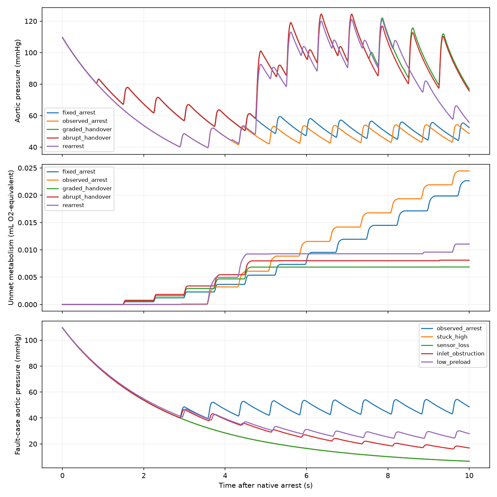

# M6 coupled controller, handover and fault experiments

2026-10-15. Thirteen scenarios, nominal/refined hydraulic runs, and paired metabolic replay where the hydraulic domain permits. These experiments test policy effects, not a biologically implemented controller or safe recovery duration.

The observed policy uses causal 0.75 s pressure/native-output filtering, 50 ms sampling, 0.25 s confirmation and 0.25 s signal/recruitment delay. One case halves sampling to 25 ms. The sensor prehistory is an explicit constant initial-pressure/5.213513 L/min assumption for every policy, not newly simulated pre-arrest physiology. The fixed schedule knows arrest onset; that privileged information is not evidence of better sensing.

| Case | Actual release s | Final 2 s mean AO mmHg | Auxiliary left L/min | Unmet metabolism mL O2-equivalent | Outcome |
|---|---:|---:|---:|---:|---|
| fixed_arrest | 0.5000 | 50.1432 | 1.8047 | 0.0227 | completed horizon; adequacy separately screened |
| observed_arrest | 2.6000 | 49.0071 | 1.8051 | 0.0245 | completed horizon; adequacy separately screened |
| observed_noise | 2.6500 | 48.8457 | 1.8046 | 0.0250 | completed horizon; adequacy separately screened |
| stuck_high | — | 8.2063 | 0.0000 | 3.8722 | completed horizon; adequacy separately screened |
| sensor_loss | — | 8.2063 | 0.0000 | 3.8722 | completed horizon; adequacy separately screened |
| graded_handover | 0.5000 | 95.6289 | 0.0163 | 0.0069 | completed horizon; adequacy separately screened |
| abrupt_handover | 0.5000 | 93.0440 | 0.0000 | 0.0081 | completed horizon; adequacy separately screened |
| rearrest | 2.6000 | 78.4910 | 1.5770 | 0.0111 | completed horizon; adequacy separately screened |
| ventilation_loss | 2.6000 | 49.0071 | 1.8051 | 0.0245 | completed horizon; adequacy separately screened |
| inlet_obstruction | 2.6000 | 18.1733 | 0.3695 | 2.1156 | completed horizon; adequacy separately screened |
| low_preload | 2.6500 | 27.0956 | 0.8335 | 0.9580 | completed horizon; adequacy separately screened |
| domain_boundary | — | — | — | — | domain stop; no extrapolated metabolism |
| observed_fast_sample | 2.5750 | 49.0862 | 1.8048 | 0.0241 | completed horizon; adequacy separately screened |

## Reading the results

SUPPORT denotes actuator command, not physiological adequacy. The coupled observed controller conservatively receives recovery adequacy=false because online tissue/recovery certification is absent; it does not automatically withdraw on pressure alone. Abrupt/graded handovers are explicitly prescribed scenarios. Synthetic policy tests separately exercise qualified recovery and aborted withdrawal. This is a retained limitation, not a claim of autonomous metabolic control.

Native restart starts at 4 s with a 1 s ramp. Systemic reopening starts at 5 s over 2 s. Native-organ demand restoration starts independently at 5.5 s over 2 s. Preserved-lung ventilation/perfusion allocation remains unchanged; all restored demand must compete for the actual available supply. Scheduled withdrawal starts at 7 s over 0 or 2 s. Re-arrest occurs at 8 s in its own observed-policy case. No repair or biochemical injury process is simulated.

Metabolic demand uses the measured auxiliary command envelope; maintenance persists when inactive and workload cost is recalculated from each hydraulic trajectory. The offline work normalization is not causal energetic feedback. The glucose-versus-oxygen components in summary.json are saved-sample quadrature; the combined deficit above is the ODE ledger and can differ slightly at narrow events. No numerical or domain failure is labeled a tissue-survival result.

Sampling sensitivity: {"default_release_s": 2.6, "fine_release_s": 2.575, "default_MAP_mmHg": 49.00706925523821, "fine_MAP_mmHg": 49.08619691019862}. This is distinct from paired ODE-tolerance refinement, which retains the same sensor sampling.

## Verification and limits

All hydraulic cases check conserved blood, continuous physical states across integration segments, finite septal residuals, nonnegative valve flows and chamber energy identities. Saved PV quadrature is checked separately. Paired state/pressure/flow scaled differences must remain below 0.005; activation time and controller transition traces must match. Metabolic replay checks paired convergence, oxygen/glucose balances, finite stores and oxidation stoichiometry. Recovery ramps do not reset the auxiliary beat phase. Abrupt withdrawal intentionally changes the pressure law without teleporting blood.

No test establishes a viable auxiliary design. Source/model limitations, assumed reduced demands, missing local glucose buffering, lack of supply-dependent contractility, absent CO2 and absent injury/blood-compatibility models remain. Low preload and obstruction are synthetic stresses; no real fault probability is assigned. The fixed and observed policies share initial physical inventory, but their capabilities differ in knowledge of arrest onset.

[Failure-mode coverage](../../docs/failure-modes.md) · [Controller specification](../../docs/m6-controller-specification.md) · [M6 closure](../../docs/m6-closure.md)

Full regression suite: 254 passed. Reproduce hydraulics with `scripts/run_m6_coupled.py`, metabolic replay with `scripts/run_m6_metabolism.py`, then this report with `scripts/report_m6_coupled.py`.
